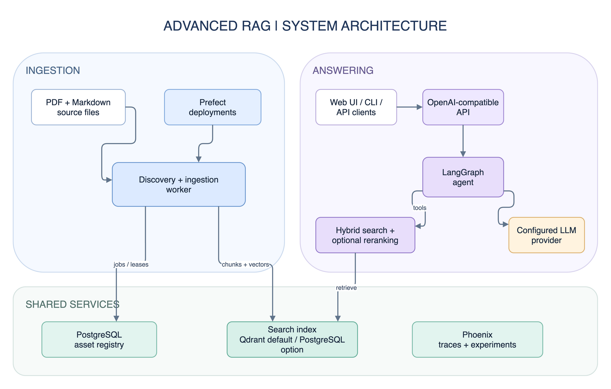

# Advanced RAG Pipeline

**From changing documents to grounded answers, end to end.** This project combines incremental ingestion, table-aware PDF parsing, hierarchical indexing, hybrid retrieval, and a multi-agent answer workflow in a runnable RAG stack. It includes an OpenAI-compatible API, Prefect orchestration, and Phoenix tracing and evaluation.

## Architecture at a Glance



The [architecture guide](docs/architecture.md) explains ingestion, query, storage, and evaluation flows with detailed Mermaid diagrams. You can edit the overview in [draw.io](docs/architecture/overview.drawio).

## What Makes It Different

- **Ingestion that tracks change.** Content hashes skip unchanged files and queue modified ones for reprocessing. Discovery tracks removed sources, while database leases let multiple workers claim jobs safely.
- **Parsing that preserves context.** Docling converts PDFs into page-aware Markdown. Tables are extracted with surrounding text, optionally summarized, and indexed separately. Headings guide the split into larger parent passages and smaller searchable child chunks.
- **Retrieval with two backends.** Use Qdrant's dense and sparse search or PostgreSQL vector and full-text search. Both paths reconstruct parent context, support metadata filters, and can apply a reranker.
- **An agent that checks its work.** A LangGraph workflow routes requests, uses semantic, page, and table lookup tools, and can verify answers against retrieved sources. Unsupported drafts trigger a bounded correction loop or a fallback response.
- **A runnable system with feedback.** Docker Compose brings up the API, worker, stores, Prefect, Phoenix, and Web UI. Ground-truth experiments and trace-based drift checks help inspect behavior after deployment.

## Start Here

Use this file as the landing page, then go to detailed guides in [`docs/`](docs/README.md).

- [Documentation Index](docs/README.md)
- [Architecture](docs/architecture.md)
- [Getting Started](docs/getting-started/README.md)
- [Configuration](docs/configuration/README.md)
- [Retrieval RRF Semantics](docs/configuration/retrieval-rrf.md)
- [Generation Model Settings](docs/configuration/generation-models.md)
- [Ingestion Rules](docs/ingestion/README.md)
- [Agents & Prompt Profiles](docs/agents/README.md)
- [Evaluation Pipeline](#evaluation-pipeline)

## Quick Start

```bash
# Clone and install
git clone <your-repo-url> && cd advanced-rag
uv sync --extra dev

# Configure
cp .env.example .env
# Optional: Set HF_TOKEN in .env if you use gated models or hit rate limits.
# For standard use with default models, you can leave it blank.

# Start local infrastructure and services
docker compose --project-directory . -f docker/docker-compose.yaml up -d

# Open Prefect dashboard
# http://localhost:4200

# Register a clickable deployment in Prefect UI (one-time or after flow changes)
uv run --extra ingestion python -m orchestration.ingestion.flows end_to_end \
  --register-deployment --deployment-name ingest-documents --work-pool rag-work-pool

# Equivalent Makefile shortcut
make register-ingestion-deployment

# Register both document ingestion + destructive reset deployments
make register-ingestion-deployments

# Start CLI
uv run rag_core/cli.py
```

## Testing

The test suite is split by runtime boundary so you do not have to install every dependency just to get fast feedback.

```bash
# Fast local unit tests that only need the core + dev dependencies
make test

# API route and response tests in the live API container
make test-api

# Prefect / orchestration / evaluation tests in the live worker container
make test-worker

# Run all three suites in sequence
make test-all
```

Layout:
- `tests/test_*.py` is the fast local suite.
- `tests/api/` contains FastAPI-specific tests.
- `tests/worker/` contains Prefect and evaluation tests.

`make test` is safe on a fresh clone. `uv` will make sure the local environment is ready on demand, and it will reuse the existing cache when nothing changed.

`make test-api` and `make test-worker` automatically bring up the core stack first, then run the tests inside the already-running service containers. This keeps local DX fast while avoiding a separate one-off test container.

If you want to run the full suite locally in your IDE or work on API/worker tests outside Docker, install every optional dependency once with `uv sync --all-extras`.

## Changing the Embedding Model

An index must use the same embedding model for stored documents and incoming queries. A different vector dimension is incompatible with the existing index; even with the same dimension, vectors from two models do not share a reliable meaning. Rebuild the selected index after changing `EMBEDDING_MODEL_NAME` or `EMBEDDING_PROVIDER`:

```bash
INGESTION_OVERWRITE=true uv run python -m rag_core.ingestion.pipeline
```

This one-off run resets the selected backend's indexed content and re-ingests the source documents. Leave `INGESTION_OVERWRITE` disabled for normal runs. See [index lifecycle and storage choices](docs/architecture.md#index-lifecycle-and-model-changes) for the full context.

Provider names are intentionally strict. If you add a new embedding backend,
update the enum and factory wiring described in
[`docs/configuration/README.md`](docs/configuration/README.md#adding-an-embedding-provider).

## Applying Configuration Changes

If you modify your `.env` file (e.g., changing API keys or switching providers), run the following to restart containers with the new variables without losing data:

```bash
make reload
```

## Database Migrations

Use `make` shortcuts for Alembic commands (config is wired to `db/alembic.ini`).

```bash
# Apply latest migration
make migrate-up

# Upgrade/downgrade to a specific revision (or relative step like -1 / +1)
make migrate-up REV=<revision_or_step>
make migrate-down REV=<revision_or_step>

# Create a new autogenerate migration
make migrate-new MSG="describe schema change"

# Show migration history
make migrate-status
```

## Worker Behavior

The canonical ingestion entrypoint is `rag_core.ingestion.pipeline`. Discovery
queues source files in Postgres, then the worker claims queued assets
and processes them until no claimable work remains.

By default, `max_jobs` is `None`, which means the worker drains the queue and
processes all available files. Multiple workers can run at the same time because
asset claims are coordinated through database leases.

`INGESTION_DEFAULT_MAX_JOBS` is an optional limit for local testing, smoke tests,
canary runs, or bounded orchestrator tasks. Leave it commented out for the
default drain-the-queue behavior.

## Prefect UI Trigger

Use Deployments in Prefect UI for one-click ingestion runs:
1. Start stack (`docker compose --project-directory . -f docker/docker-compose.yaml up -d`).
2. Open `http://localhost:4200`, go to **Deployments**.
3. Start ingestion from `ingest-documents` via **Quick Run** (or create a **Schedule** from that deployment page).
4. If `ingest-documents` is missing, register deployments with `make register-ingestion-deployments`, then refresh the Deployments page.

For destructive reset operations, run the separate `reset-document-index` deployment and set `confirm_destructive_wipe=true`.

If runs fail on first start due to missing schema, run:

```bash
make migrate-up
```

If Docker builds fail with `No space left on device` while extracting NVIDIA/CUDA wheels, use the default lightweight extras (already in `.env.example`) or clean disk first:

```bash
docker system prune -af --volumes
uv cache clean
```

## Folder Conventions

- `docs/` contains project guides and operational documentation.
- `data/source_documents/` contains ingestable source files (`.pdf`, `.md`).
- Folder-tag behavior and ignore rules for ingestion are documented in:
  - [`docs/ingestion/README.md`](docs/ingestion/README.md)
  - [`data/source_documents/README.md`](data/source_documents/README.md)
- Metadata extraction extension hooks (scopes/tags/extended metadata) are also documented in:
  - [`docs/ingestion/README.md`](docs/ingestion/README.md)

## Evaluation Pipeline

The evaluation subsystem runs registry-backed RAGAS metrics plus deterministic project judges against a ground truth QA dataset, storing results as Phoenix Experiments with full trace correlation.

> [!NOTE]
> The worker image includes evaluation libraries (ragas, phoenix) by default.
> `make eval` runs directly against the running worker — no rebuild needed.

### How It Works

```text
  ground_truth_dataset.csv ──→ Phoenix Dataset ("ground-truth-v1")
                        │
                        ▼
      run_ground_truth_evaluation (Prefect @flow)
                        │
        ┌───────────────┼───────────────┐
        ▼               ▼               ▼
  resolve_dataset   run_experiment   apply_thresholds
                        │
              ┌─────────┴─────────┐
              ▼                   ▼
     RAGAS Evaluators     Project Judges
  (Faithfulness, etc.)  (Citation format)
              │                   │
              └─────────┬─────────┘
                        ▼
              Prefect markdown artifact
           (Phoenix UI link + metrics table)
```

1. The ground truth QA set (`evaluation/datasets/ground_truth_dataset.csv`) is uploaded to Phoenix as a versioned Dataset (idempotent by content hash).
2. `run_ground_truth_evaluation` constructs a `RAGPipeline` once, runs it per example via `phoenix.experiments.run_experiment`, and evaluates with `GROUND_TRUTH_EVALUATORS`.
3. Results are stored as a Phoenix Experiment (visible in the Phoenix UI with per-example traces) and summarised as a Prefect markdown artifact.
4. Scores are logged to Phoenix and summarized as a Prefect artifact. The registry-backed CE flows do not fail only because a metric is low.

### Quick Start: Run Evaluation

```bash
# 1. Start infrastructure (includes Phoenix at http://localhost:6006)
make up

# 2. Upload ground truth dataset (idempotent)
docker compose --project-directory . --env-file .env -f docker/docker-compose.yaml \
  exec rag-worker .venv/bin/python -c \
  "from evaluation.datasets.loaders import ensure_dataset_uploaded; \
   from evaluation.config import get_eval_config; \
   print(ensure_dataset_uploaded(get_eval_config()))"

# 3. Run an experiment (one-shot)
make eval
# Or with a custom experiment name:
docker compose --project-directory . --env-file .env -f docker/docker-compose.yaml \
  exec rag-worker .venv/bin/python -c \
  "from orchestration.evaluation.prefect_flows import run_ground_truth_evaluation; \
   run_ground_truth_evaluation(experiment_name='my-first-eval')"

# Optional: run trace-based drift detection on demand
make eval-drift

# 4. Verify in Phoenix UI (http://localhost:6006):
#    - Project "advanced-rag-eval" exists
#    - Dataset "ground-truth-v1" appears
#    - Experiment shows row count == ground truth row count
#    - Each row has evaluator scores + full RAG span tree

# 5. Register all Prefect deployments manually if needed:
make register-eval-deployment
```

`make eval` runs ground truth evaluation using the unified worker image. It
starts only backend infrastructure (`make up-core` — no Open-WebUI) and
exec's into the running worker container.

```bash
# Default: evaluate against ground_truth_dataset.csv
make eval

# Custom dataset by short name — Python resolves "adversarial" to
# evaluation/datasets/adversarial.csv automatically
make eval DATASET=adversarial

# Also works with full filename or path
make eval DATASET=adversarial_dataset.csv
make eval DATASET=evaluation/datasets/adversarial_dataset.csv

# Override the Phoenix Dataset name (default: auto-derived from filename)
make eval DATASET=adversarial NAME=adversarial-v2

# With reranking enabled
make eval EVAL_STATIC_RERANK_ENABLED=true
```

`EVAL_STATIC_RERANK_ENABLED` is a `make eval` / `make eval-drift` passthrough. It is not read by `evaluation.config.EvalConfig`; use it only when you want the worker-side reranker enabled for the evaluation command.

> [!IMPORTANT]
> Custom datasets are uploaded to Phoenix as **separate Datasets** (not overwriting the ground truth). The Phoenix dataset name is auto-derived from the CSV filename (`adversarial_dataset.csv` → `adversarial-dataset`). Override with `NAME=custom-name` if needed.

> [!TIP]
> Place custom CSV datasets in `evaluation/datasets/`. The CSV must have `question`, `ground_truth` columns matching the ground truth format. You can pass just the name — `.csv` extension and directory prefix are added automatically.

### Evaluation Modes

| Mode | Flow | Trigger | Ground Truth | Description |
|------|------|---------|-------------|-------------|
| **Ground truth** | `run_ground_truth_evaluation` | `EVAL_STATIC_SCHEDULE_CRON` or manual | ✅ Required | Runs `GROUND_TRUTH_EVALUATORS` against `ground_truth_dataset.csv` |
| **Trace-based** | `run_nightly_drift_detection` | `EVAL_DRIFT_SCHEDULE_CRON`, `make eval-drift`, or Prefect dashboard (`evaluate-drift`) | ❌ Not needed | Stratified evaluation of production final answers with cohort tagging |
| **Synthetic QA** | `synthetic_qa_flow` | Manual | N/A | Generates QA pairs from document store → Phoenix Dataset |

### Trace-Based Drift Detection

`run_nightly_drift_detection` evaluates **final user-facing answers** from production traces, not intermediate rejected drafts. It produces three distinct signals:

| Signal | What It Measures | How |
|--------|-----------------|-----|
| **System Health** | Did the user get a good answer? | LLM judges (`ce.faithfulness`, `ce.answer_relevancy`) on final answers |
| **Agent Efficiency** | How often did the agent retry before succeeding? | Sum of `custom.intervention_count` across all spans (no LLM judge) |
| **Cohort Segmentation** | Are retried answers as good as first-try answers? | `ce.cohort` annotation (`high_risk` / `baseline`) for dashboard charting |

#### How It Works

The `post_processing` LangGraph node stamps an `agent.generation.metrics` marker span on **every** request with:

```text
custom.intervention_count = 0   → agent got it right on the first try
custom.intervention_count = 2   → agent retried twice before the verifier passed it
question, answer, contexts      → ready for LLM judges
```

The drift flow queries these spans and **stratifies** into two cohorts:

```text
┌─────────────────────────────────────────────────────────────┐
│  agent.generation.metrics spans (last N minutes)            │
│                                                             │
│  ┌─────────────────────┐   ┌────────────────────────────┐  │
│  │  Cohort A: High-Risk│   │  Cohort B: Baseline        │  │
│  │  intervention > 0   │   │  intervention == 0         │  │
│  │  EVAL_DRIFT_HIGH_RISK_SAMPLE_MAX=5                     │  │
│  │  EVAL_DRIFT_BASELINE_SAMPLE_MAX=5                      │  │
│  └────────┬────────────┘   └────────────┬───────────────┘  │
│           │                             │                   │
│           ▼                             ▼                   │
│     ce.faithfulness              ce.faithfulness             │
│     ce.answer_relevancy          ce.answer_relevancy         │
│     ce.cohort = "high_risk"      ce.cohort = "baseline"      │
└─────────────────────────────────────────────────────────────┘
```

This lets Phoenix chart **two separate trend lines** instead of one diluted average:

- *Baseline Faithfulness: 99%* — clean traffic is reliable
- *High-Risk Faithfulness: 50%* — self-correction loop needs attention

#### Running Drift Detection

**On demand:**

```bash
make eval-drift
```

**From Prefect dashboard:**

1. Open Prefect UI at `http://localhost:4200`
2. Go to **Deployments** → **evaluate-drift**
3. Click **Quick Run** for a one-shot run, or create a **Schedule** for recurring runs

**With a cron schedule (automatic):**

```bash
# 1. Set cron in .env — run every night at 2 AM
EVAL_DRIFT_SCHEDULE_CRON=0 2 * * *

# 2. Restart containers to pick up the new env value
make reload

# 3. Re-register deployments with the new cron schedule
make register-eval-deployment
```

> [!IMPORTANT]
> Just setting `EVAL_DRIFT_SCHEDULE_CRON` in `.env` is not enough — you must also run `make register-eval-deployment` to upsert the Prefect deployment with the new cron schedule. After that, the Prefect worker will execute drift detection automatically on schedule.

**Custom lookback window:**

```bash
docker compose --project-directory . --env-file .env -f docker/docker-compose.yaml \
  exec rag-worker .venv/bin/python -c \
  "from orchestration.evaluation.prefect_flows import run_nightly_drift_detection; \
   print(run_nightly_drift_detection(lookback_minutes=240))"
```

The flow searches the last `EVAL_DRIFT_LOOKBACK_MINUTES` minutes (default `60`).

#### Tuning Drift Detection

| Variable | Default | Description |
|----------|---------|-------------|
| `EVAL_DRIFT_LOOKBACK_MINUTES` | `60` | Time window to query for production spans |
| `EVAL_DRIFT_HIGH_RISK_SAMPLE_MAX` | `5` | Cap on high-risk (retried) traces to evaluate. Use `5` for quick local testing; for production, start around `50-100` and scale with traffic volume and token budget |
| `EVAL_DRIFT_BASELINE_SAMPLE_MAX` | `5` | Random sample of clean first-try traces. Kept low to save judge cost |
| `EVAL_DRIFT_SCHEDULE_CRON` | _(empty)_ | Cron expression for automatic scheduling (e.g., `0 2 * * *` for nightly at 2 AM) |

> [!TIP]
> Start with the defaults. For quick local drift runs, `EVAL_DRIFT_HIGH_RISK_SAMPLE_MAX=5` keeps runs fast and cheap. For production, increase it to roughly `50-100` based on your traffic volume and token budget. If your agent rarely retries, lower `EVAL_DRIFT_HIGH_RISK_SAMPLE_MAX`. If you want tighter baseline monitoring, increase `EVAL_DRIFT_BASELINE_SAMPLE_MAX` - but each example costs one LLM judge call per metric.

#### Viewing Results in Phoenix

After `make eval-drift` runs, open Phoenix at `http://localhost:6006`:

1. **Annotations view** — each evaluated span has `ce.faithfulness`, `ce.answer_relevancy`, `ce.cohort`, and `ce.intervention_count` annotations
2. **Filter by cohort:**
   ```text
   annotations['ce.cohort'].label == 'high_risk'
   ```
3. **Filter by low scores:**
   ```text
   annotations['ce.faithfulness'].score < 0.5
   ```
4. **Metrics tab** — plot `ce.faithfulness`, `ce.answer_relevancy`, and `ce.intervention_count` over time, segmented by `ce.cohort`

A **Prefect markdown artifact** (`drift-detection-summary`) is also created with a summary table showing total interventions, cohort breakdown, and average scores. View it in the Prefect UI under **Artifacts** or on the flow run page.

#### Debugging Spans

The self-correcting agent also emits `agent.verification.rejected` marker spans for **visual debugging** in Phoenix. These carry `custom.attempt_number` and `custom.verification_reason` so you can inspect exactly which draft failed and why:

```text
name == 'agent.verification.rejected'
```

> [!NOTE]
> The rejection spans are for human debugging only. The drift detection flow ignores them and uses `agent.generation.metrics` spans exclusively — these carry the final answer the user actually received.

### Threshold Gates

Set `EVAL_THRESHOLDS` to a JSON dict to enforce minimum scores:

```bash
# Fail the flow if faithfulness < 0.9 or context_recall < 0.85
EVAL_THRESHOLDS='{"faithfulness": 0.9, "context_recall": 0.85}'
```

The registry-backed CE flows log scores to Phoenix and do not raise only because
a metric is low. `EVAL_THRESHOLDS` remains available for legacy threshold reports
and older evaluation paths.

### Post-Ingestion Hook

To automatically run evaluation after each ingestion:

```bash
EVAL_STATIC_AUTO_RUN_AFTER_INGESTION=true
```

The hook is non-blocking — eval failures are logged but never break ingestion.

### EVAL_* Environment Variables

Preferred names use the `EVAL_STATIC_` and `EVAL_DRIFT_` prefixes below.

#### Global Judge & Platform Settings

| Variable | Default | Description |
|----------|---------|-------------|
| `EVAL_PHOENIX_PROJECT` | `advanced-rag-eval` | Phoenix project (isolated from prod) |
| `EVAL_PHOENIX_ENDPOINT` | _(auto)_ | Optional override; auto-resolved from Phoenix/OTEL when unset |
| `EVAL_JUDGE_PROVIDER` | `aws` | LLM provider for judges |
| `EVAL_JUDGE_MODEL` | _(provider default)_ | Override judge model |
| `EVAL_TIMEOUT` | `120` | Maximum time to wait for a single metric evaluation |
| `EVAL_MAX_RETRIES` | `3` | Maximum retries for a failed metric evaluation |
| `EVAL_MAX_WORKERS` | `4` | Maximum concurrent evaluation tasks |
| `EVAL_RAGAS_METRICS` | `faithfulness,answer_relevancy,...` | RAGAS metrics to run |
| `EVAL_PHOENIX_EVALUATORS` | `hallucination,qa_correctness,relevance` | Legacy Phoenix judges setting; not used by the registry-backed CE ground-truth flow |
| `EVAL_THRESHOLDS` | _(empty)_ | JSON dict of metric → min score |
| `EVAL_FACTUALITY_WEIGHT` | `0.85` | Weight for factual correctness in AnswerCorrectness |

#### Static Datasets (`make eval`)

| Variable | Default | Description |
|----------|---------|-------------|
| `EVAL_STATIC_SCHEDULE_CRON` | _(empty)_ | Cron for scheduled ground truth eval |
| `EVAL_STATIC_DATASET_NAME` | `ground-truth-v1` | Phoenix Dataset name |
| `EVAL_STATIC_DATASET_CSV_PATH` | `evaluation/datasets/ground_truth_dataset.csv` | Ground truth CSV path |
| `EVAL_STATIC_MAX_EXAMPLES` | _(all)_ | Hard cap to bound judge cost |
| `EVAL_STATIC_CSV_ARTIFACT_ENABLED` | `false` | Emit CSV Prefect artifact |
| `EVAL_STATIC_AUTO_RUN_AFTER_INGESTION` | `false` | Run eval after ingestion |
| `EVAL_STATIC_RERANK_ENABLED` | `true` | Enable worker-side reranker for evaluation runs |

#### Continuous Drift (`make eval-drift`)

| Variable | Default | Description |
|----------|---------|-------------|
| `EVAL_DRIFT_SCHEDULE_CRON` | _(empty)_ | Cron for trace-based eval |
| `EVAL_DRIFT_LOOKBACK_MINUTES` | `60` | Time window to query for production spans |
| `EVAL_DRIFT_HIGH_RISK_SAMPLE_MAX` | `5` | Cap on high-risk (retried) traces to evaluate. Higher = more thorough but more judge cost |
| `EVAL_DRIFT_BASELINE_SAMPLE_MAX` | `5` | Random sample of clean first-try traces. Kept low to save judge cost |

> [!TIP]
> **OSS users without AWS:** Set `EVAL_JUDGE_PROVIDER=ollama` (or `lmstudio`) and `EVAL_JUDGE_MODEL=<your-model>` to use local judge models.

### Evaluation Package Structure

```text
evaluation/
├── config.py                    # EvalConfig(BaseSettings) + feature flags
├── phoenix_bootstrap.py         # Lazy phoenix.Client() factory
├── datasets/
│   ├── ground_truth_dataset.csv              # Golden QA set (hand-curated)
│   └── loaders.py               # CSV→Phoenix Dataset upload (idempotent)
├── generation/
│   └── synthetic.py             # Async QA generation → Phoenix Dataset
├── pipeline/
│   ├── task.py                  # run_rag_for_example (per-example isolation)
│   └── adapter.py               # Phoenix ↔ RAG ↔ RAGAS shape conversion
├── evaluators/
│   ├── ragas_metrics.py         # RAGAS metric → Phoenix evaluator factory
│   ├── custom_judges.py         # Deterministic project-specific judges
│   ├── phoenix_judges.py        # Legacy reference-free LLM-as-judge evaluators
│   └── thresholds.py            # Pass/fail policy (PassFailReport)
├── eval_registry.py             # GROUND_TRUTH_EVALUATORS + DRIFT_EVALUATORS
├── reporting/
│   └── artifacts.py             # Prefect markdown + CSV artifacts
└── orchestration/
    ├── prefect_flows.py         # Canonical CE flows
    ├── flows.py                 # Legacy wrappers + synthetic_qa
    ├── tasks.py                 # @task wrappers (one per stage)
    └── deployments.py           # Eval deployment specs
```

## Project Structure

```text
advanced-rag/
├── app/                    # API transport layer
├── orchestration/          # Prefect flows/worker runtime
├── rag_core/               # Core RAG engine
├── evaluation/             # Evaluation pipeline
│   ├── config.py           #   EvalConfig + feature flags
│   ├── datasets/           #   Golden QA sets + loaders
│   ├── evaluators/         #   RAGAS + Phoenix judge factories
│   ├── pipeline/           #   Per-example task + adapters
│   ├── reporting/          #   Prefect artifact emitters
│   └── orchestration/      #   Flows, tasks, deployment specs
├── docker/
├── docs/
├── data/source_documents/
├── tests/
└── examples/
```

## License

MIT
