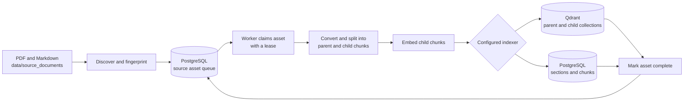
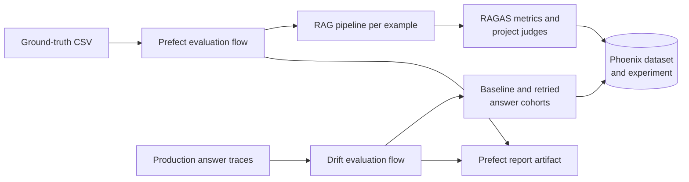

# Architecture

This guide describes the running system and the paths a document and a user question take through it. The [README overview](../README.md#architecture-at-a-glance) is the short version; the [draw.io source](architecture/overview.drawio) is editable in diagrams.net.

## Components and boundaries

| Component | Responsibility | Main implementation |
| --- | --- | --- |
| API | Exposes OpenAI-compatible chat and streaming endpoints | [`app/routes/openai.py`](../app/routes/openai.py), [`app/services/rag_service.py`](../app/services/rag_service.py) |
| Agent | Routes a request, calls retrieval tools, verifies and formats an answer | [`rag_core/genetation/graph.py`](../rag_core/genetation/graph.py), [`rag_core/genetation/tools.py`](../rag_core/genetation/tools.py) |
| Retrieval | Searches child chunks, returns parent context, optionally reranks it | [`rag_core/retrieval/search_service.py`](../rag_core/retrieval/search_service.py) |
| Ingestion | Discovers source assets, claims jobs, processes files, writes an index | [`rag_core/ingestion/pipeline.py`](../rag_core/ingestion/pipeline.py), [`rag_core/ingestion/services/worker.py`](../rag_core/ingestion/services/worker.py) |
| Orchestration | Runs ingestion and evaluation deployments through Prefect | [`orchestration/ingestion/flows.py`](../orchestration/ingestion/flows.py), [`orchestration/evaluation/prefect_flows.py`](../orchestration/evaluation/prefect_flows.py) |
| Storage | Keeps asset state in PostgreSQL and searchable content in the selected index | [`rag_core/indexing/factory.py`](../rag_core/indexing/factory.py), [`rag_core/retrieval/factory.py`](../rag_core/retrieval/factory.py) |
| Observability and evaluation | Records traces and experiments in Phoenix | [`evaluation/`](../evaluation/), [`rag_core/core/telemetry.py`](../rag_core/core/telemetry.py) |

The [Docker stack](../docker/docker-compose.yaml) runs the API, worker, Prefect, PostgreSQL, Qdrant, Phoenix, and Open WebUI. Qdrant is the default retrieval index; the indexer and retriever factories also support a PostgreSQL backend. The API and worker use the same configured backend so ingestion and search address the same index.

## Document ingestion



Discovery registers new or changed files and reconciles removed sources. The worker claims queued assets using database leases, processes each file, and marks the job complete only after indexing. The end-to-end entrypoint runs discovery followed by the worker; Prefect provides the deployment and schedule around that entrypoint. See the [ingestion guide](ingestion/README.md) for supported files, metadata rules, and commands.

## Answering a question

```mermaid
flowchart LR
    client[Open WebUI or API client] --> api[Chat completions API]
    api --> graph[LangGraph agent]
    graph -->|search tool| search[RAG search service]
    search --> retrieve[Dense and sparse retrieval<br/>plus parent reconstruction]
    retrieve --> index[(Selected search index)]
    retrieve --> rerank[Optional reranker]
    rerank --> graph
    graph -->|reason and verify| llm[Configured LLM provider]
    llm --> graph
    graph --> api
    api --> client
    api -. telemetry .-> phoenix[Phoenix]
```

The API accepts OpenAI-compatible requests and invokes the agent graph. The graph can call semantic search, page lookup, or table lookup. The search service selects the configured retriever, records retrieval scores, and optionally reranks returned parent documents. Qdrant combines dense and sparse results with reciprocal rank fusion; the PostgreSQL retriever combines vector and full-text rankings. The API returns a normal completion or a streamed response. See [retrieval RRF semantics](configuration/retrieval-rrf.md) and [generation model settings](configuration/generation-models.md) for the tuning points.

## Index lifecycle and model changes

The asset registry and the retrieval index have different jobs. PostgreSQL tracks ingestion runs, source assets, claims, and retries regardless of retrieval backend. Searchable parent and child content lives in Qdrant by default, or in PostgreSQL when that backend is selected.

Document vectors and query vectors must come from the same embedding model. Changing `EMBEDDING_MODEL_NAME` or `EMBEDDING_PROVIDER` requires rebuilding the selected index: a different dimension cannot fit the existing vector schema, and equal dimensions do not make two models semantically compatible. Run a one-off overwrite ingestion after updating the configuration:

```bash
INGESTION_OVERWRITE=true uv run python -m rag_core.ingestion.pipeline
```

Overwrite resets indexed content for the selected backend before reprocessing source files. Keep it disabled during normal ingestion. The preflight checks index compatibility before work begins; [configuration](configuration/README.md) covers backend and provider settings.

## Evaluation and observability



Ground-truth runs evaluate a versioned dataset and save experiment results in Phoenix. Drift runs sample final production answers from traces, split them into baseline and retried cohorts, and attach judge annotations. Prefect exposes the runs and summary artifacts. The [evaluation section](../README.md#evaluation-pipeline) has the commands and metric settings.
